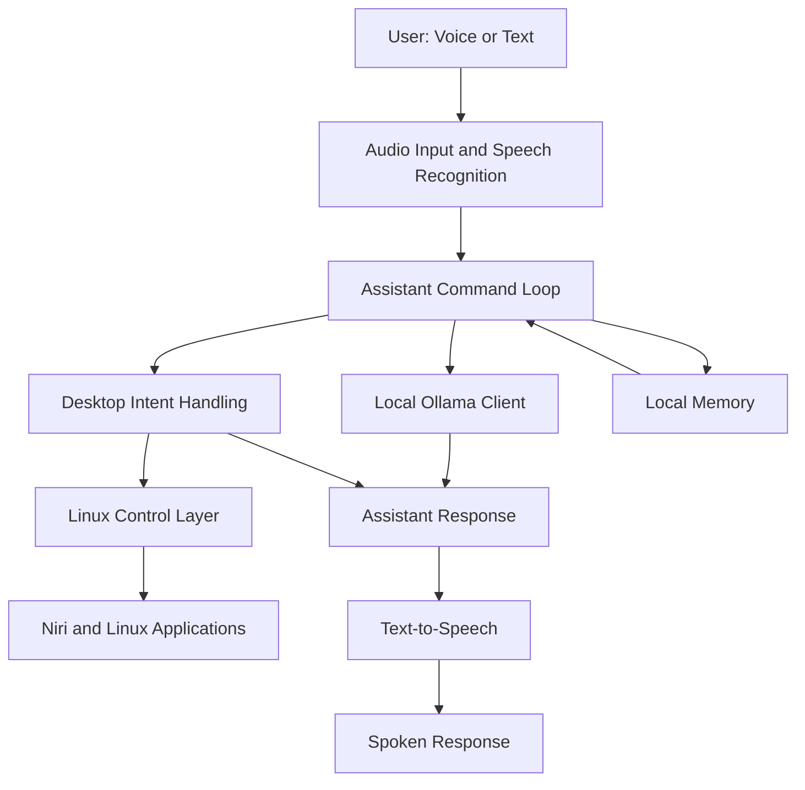

# JARVIS — AI Desktop Assistant

**A local-first AI desktop assistant for Linux.**

JARVIS is an open-source personal AI assistant designed to bring voice interaction, local language models, persistent memory, and desktop automation together in one application.

The goal is simple: build an assistant that can understand natural language, respond with a voice, remember useful information, and help control your Linux desktop — while keeping the core experience local and under your control.

> **Project status:** Active development. Features, interfaces, and setup instructions may change as the project evolves.

## Table of Contents

- [Vision](#-vision)
- [Features](#-features)
- [Architecture](#-architecture)
- [Technology Stack](#-technology-stack)
- [Requirements](#-requirements)
- [Installation](#-installation)
- [Running JARVIS](#-running-jarvis)
- [How It Works](#-how-it-works)
- [Project Structure](#-project-structure)
- [Privacy and Security](#-privacy-and-security)
- [Development](#-development)
- [Roadmap](#-roadmap)
- [Troubleshooting](#-troubleshooting)
- [Contributing](#-contributing)
- [License](#-license)

## 🚀 Vision

Most desktop assistants depend on cloud services, external APIs, or subscriptions. JARVIS explores a different approach: a personal assistant that runs primarily on your own computer.

The long-term vision is to create a practical Linux desktop companion that can:

- Understand everyday spoken and typed instructions.
- Hold natural conversations using a locally running language model.
- Listen for a wake word and respond when addressed.
- Speak responses through text-to-speech.
- Understand the current desktop environment.
- Open applications and manage supported desktop operations.
- Remember user-approved information across sessions.
- Automate repetitive development and desktop workflows.

JARVIS is being built incrementally, prioritizing a reliable foundation over an assistant that only appears intelligent in a demonstration.

## ✨ Features

### 🧠 Local AI

- Integration with Ollama for local language-model inference.
- Structured intent handling for supported assistant actions.
- A foundation for interpreting natural-language desktop commands.
- Configurable connection to the local Ollama API.

### 🎙️ Voice Interaction

- Speech recognition using Faster-Whisper.
- Text-to-speech integration using Piper.
- Wake-word functionality using openWakeWord.
- Audio noise-suppression support.
- Voice-oriented interaction through the assistant's command loop.

### 🖥️ Linux Desktop Control

- Desktop and application discovery.
- Focused-window information.
- Workspace and monitor awareness.
- Workspace switching through supported Niri commands.
- Application and developer-workflow automation as the project evolves.

Desktop operations are implemented through dedicated Python modules rather than placing all system-control logic directly inside the conversation loop.

### 💾 Persistent Memory

- SQLite-based local storage.
- A foundation for retaining useful information across sessions.
- A design intended to support user-controlled memory.

### 🛠️ Developer-Friendly Design

- Python source code organized into separate modules.
- Dependency management with `uv`.
- Automated checks and tests for selected components.
- A dedicated launcher script.
- A local-first architecture designed for experimentation and extension.

**Note:** JARVIS is still evolving. Not every capability described in the long-term vision is complete, fully integrated, or guaranteed to work on every Linux distribution.

## 🏗️ Architecture

JARVIS separates conversational intelligence, speech processing, memory, and desktop operations into individual components.



The diagram represents the intended high-level architecture. Individual paths and integrations are being developed and refined.

### Design principles

1. **Local-first:** Prefer locally running components over paid cloud APIs.
2. **Modularity:** Keep speech, memory, AI communication, and system control separate.
3. **Safety:** Validate desktop actions before executing them.
4. **Transparency:** Make it possible to understand how commands are interpreted and executed.
5. **Incremental development:** Implement and verify features in manageable steps.

## 🧰 Technology Stack

| Component | Technology |
|---|---|
| Language | Python |
| Dependency management | `uv` |
| Local LLM runtime | Ollama |
| Language model | Qwen 2.5 3B Instruct |
| Speech recognition | Faster-Whisper |
| Text-to-speech | Piper |
| Wake-word detection | openWakeWord |
| Audio processing | SoundDevice and noise-suppression components |
| Persistent storage | SQLite |
| Desktop integration | Niri and Linux command-line interfaces |
| Version control | Git and GitHub |

The exact dependency versions and configuration are defined by the project files and may change over time.

## 💻 Requirements

JARVIS is currently developed around the following environment:

- Linux desktop.
- Python version compatible with the project configuration.
- `uv` for Python environment and dependency management.
- Ollama installed and running locally.
- A compatible model downloaded through Ollama.
- Microphone and audio output for voice interaction.
- Additional audio system dependencies required by the selected speech components.

### Development environment

The primary development environment is:

- Arch Linux
- Niri Wayland compositor
- PipeWire audio system
- NVIDIA RTX 4060 Laptop GPU with 8 GB VRAM
- 16 GB system RAM

Your hardware requirements may differ depending on the model, speech-recognition configuration, and whether GPU acceleration is enabled.

Desktop automation currently targets Linux and includes Niri-specific functionality. Other desktop environments may require additional integration work.

## 📦 Installation

The instructions below describe the intended setup flow for the current development environment. Some audio and GPU dependencies may require distribution-specific configuration.

### 1. Install the prerequisites

Install Git, Python, `uv`, and Ollama using the supported installation methods for your Linux distribution.

Verify that the tools are available:

```bash
git --version
python --version
uv --version
ollama --version
```

Use the Python version required by the project's `pyproject.toml`. You do not need to replace your system Python if `uv` can provision a compatible project environment.

### 2. Clone the repository

```bash
git clone https://github.com/ThoufeekDev/ai-desktop-assistant.git
cd ai-desktop-assistant
```

### 3. Create the project environment and install dependencies

```bash
uv sync
```

This uses the project's dependency configuration and lockfile to set up the Python environment.

If dependency installation fails, check the error for missing system audio libraries, compiler tools, or GPU-specific dependencies.

### 4. Download the language model

Start Ollama if it is not already running, then download the configured model:

```bash
ollama pull qwen2.5:3b-instruct
```

Check that the model is available:

```bash
ollama list
```

The Ollama service must be running when JARVIS needs to send requests to it.

### 5. Configure audio

For voice interaction, ensure that:

- Your microphone is detected by Linux.
- Your audio output device is working.
- The required speech-recognition and text-to-speech dependencies are installed.
- Any required speech models are downloaded according to the project's configuration.

GPU acceleration depends on the installed libraries, drivers, and model configuration. A compatible NVIDIA GPU alone does not guarantee that every component will use the GPU.

## ▶️ Running JARVIS

From the project directory, run:

```bash
./scripts/run-jarvis
```

The launcher is the recommended entry point for the current development setup.

Once the application starts, use the interaction mode provided by the current implementation. Supported commands and voice workflows may evolve during development.

To stop the assistant, use the normal exit mechanism provided by the running application or interrupt the process in the terminal when appropriate.

## 🔄 How It Works

At a high level, the assistant combines several independent responsibilities.

### 1. Input and speech recognition

The speech-recognition component converts supported microphone input into text. This text is passed to the assistant's command-handling logic.

### 2. Language understanding

The assistant communicates with the configured local language model through an Ollama client. Desktop intent handling provides a separate place to interpret supported actions and their parameters.

Natural-language understanding is an ongoing development area. The long-term objective is to handle different ways of expressing the same request without relying entirely on exact phrase matching.

### 3. Action validation and execution

Desktop operations are handled by the Linux control layer. This separation allows supported actions to be checked and executed through dedicated functions rather than treating arbitrary model-generated text as a shell command.

Not every requested action is supported, and ambiguous or invalid requests should be handled safely.

### 4. Memory

The memory component uses SQLite to provide local persistence. The intended direction is to give users control over what information is retained and how it is used.

### 5. Spoken responses

The text-to-speech component converts supported assistant responses into audio, enabling a more natural voice-based interaction.

## 📁 Project Structure

```text
ai-desktop-assistant/
├── experiments/
│   ├── wake_word_standby.py
│   └── wake_word_test.py
├── scripts/
│   └── run-jarvis
├── src/
│   └── jarvis/
│       ├── __init__.py
│       ├── app_discovery.py
│       ├── cli.py
│       ├── config.py
│       ├── desktop_intent.py
│       ├── linux_control.py
│       ├── memory.py
│       ├── noise_suppression.py
│       ├── ollama_client.py
│       ├── package_manager.py
│       ├── speech_to_text.py
│       ├── text_to_speech.py
│       └── wake_word.py
├── tests/
├── pyproject.toml
├── uv.lock
├── .gitignore
└── README.md
```

This tree highlights the principal application modules. Individual test files and additional project configuration are omitted for readability.

## 🔒 Privacy and Security

Privacy and local control are important design goals for JARVIS.

- **Local inference:** Ollama can run the language model on your own machine.
- **Local persistence:** SQLite can store application memory locally.
- **No paid API requirement by design:** The project aims to use local and open-source components.
- **Explicit system integration:** Desktop operations are handled by dedicated Linux-control code.
- **Configuration-based connections:** The Ollama client supports configurable connection settings.

Local execution does not automatically guarantee complete privacy. Microphone access, third-party packages, network connectivity, application logs, and future integrations can affect what data is processed or transmitted.

Review the source code and configuration before using JARVIS with sensitive information. Do not expose the local Ollama API or other services to untrusted networks without appropriate protections.

## 🧪 Development

### Compile-check the application

From the repository root:

```bash
uv run python -m compileall -q src/jarvis
```

This checks Python source files for syntax errors. It does not prove that external services, audio devices, or desktop actions work correctly.

### Run the test suite

The repository includes tests for selected application components. If the development dependencies are installed, run:

```bash
uv run pytest
```

Some tests may require additional dependencies or configuration. A passing test suite does not replace manual testing of microphone input, audio output, Ollama connectivity, and desktop integration.

### Manual verification

When developing new functionality, useful checks include:

- Confirming that Ollama responds to local requests.
- Testing speech recognition with microphone input.
- Checking text-to-speech output.
- Verifying wake-word behavior.
- Confirming focused-window and workspace information.
- Testing desktop actions in the intended Niri environment.
- Checking that invalid or ambiguous commands do not trigger unintended actions.

## 🗺️ Roadmap

JARVIS is being developed incrementally.

- [x] Establish a Python application structure.
- [x] Integrate a local Ollama client.
- [x] Add speech-recognition and text-to-speech components.
- [x] Add wake-word and audio-processing components.
- [x] Introduce local persistent memory.
- [x] Add desktop and application discovery components.
- [x] Implement initial Niri workspace-awareness and workspace-control functionality.
- [ ] Improve natural-language intent parsing and reduce dependence on hard-coded command phrases.
- [ ] Strengthen action validation, clarification, and execution verification.
- [ ] Expand reliable application launching and closing.
- [ ] Improve developer-workflow automation.
- [ ] Refine conversational behavior and voice interaction.
- [ ] Improve user control over persistent memory.
- [ ] Expand documentation and supported-environment guidance.

The checklist reflects the development direction and existing components, not a guarantee that every item is production-ready.

## 🛠️ Troubleshooting

### Ollama is not responding

Check whether Ollama is installed and running:

```bash
ollama --version
ollama list
```

If the service is not running, start it using the appropriate method for your Linux setup.

### The configured model is missing

Download the model configured for the project:

```bash
ollama pull qwen2.5:3b-instruct
```

If you change models, make sure the application configuration matches the model you downloaded.

### The microphone is not detected

Check the available recording and playback devices through your Linux audio tools and verify that PipeWire and its session manager are running when applicable.

### Voice recognition or speech output fails

Check the application error output, model availability, audio-device selection, and the required system libraries. GPU acceleration and audio backends may require additional configuration.

### Desktop automation does not work

Desktop-control functionality depends on the supported Linux environment and its available commands. For Niri-specific features, confirm that Niri is running and that its message/action interface is available.

### Dependencies fail to install

Review the reported error, your Python version, and the project's dependency configuration. Avoid replacing or downgrading the system Python merely to work around a project-environment issue.

If the problem persists, open an issue with the error message, Linux distribution, relevant dependency versions, and steps to reproduce it. Remove secrets and sensitive information before sharing logs.

## 🤝 Contributing

Contributions, bug reports, suggestions, and thoughtful feedback are welcome.

If you want to contribute:

1. Check the existing issues and project roadmap.
2. Describe the problem or improvement you want to address.
3. Keep changes focused and modular.
4. Avoid introducing unnecessary cloud dependencies or paid-service requirements.
5. Test changes in the relevant environment.
6. Document new setup requirements and behavioral changes.
7. Submit a pull request with a clear description of what changed and how it was verified.

For significant architectural changes, consider opening an issue first so the approach can be discussed before implementation.

## 📄 License

A license has not yet been specified in this README. The repository should include a `LICENSE` file and identify the chosen license before the project is presented as an officially licensed open-source project.

Until a license is added, do not assume that the code may be redistributed or reused under standard open-source terms.

## 🙌 Acknowledgements

JARVIS builds on the work of open-source projects and their communities, including:

- [Ollama](https://ollama.com/) — local language-model runtime.
- [Hugging Face](https://huggingface.co/) — machine-learning models and tooling.
- [Faster-Whisper](https://github.com/SYSTRAN/faster-whisper) — speech recognition.
- [Piper](https://github.com/rhasspy/piper) — local text-to-speech.
- [openWakeWord](https://github.com/dscripka/openWakeWord) — wake-word detection.
- [Niri](https://github.com/niri-wm/niri) — scrollable-tiling Wayland compositor.

Please consult each project's documentation and license for its own terms and requirements.

---

**JARVIS — Your desktop. Your assistant. Your control.**

Built with Python, local AI, and a vision for a more capable Linux desktop.
